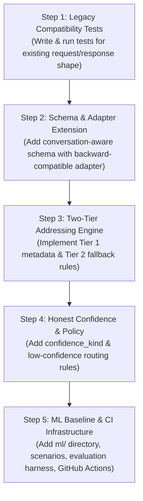
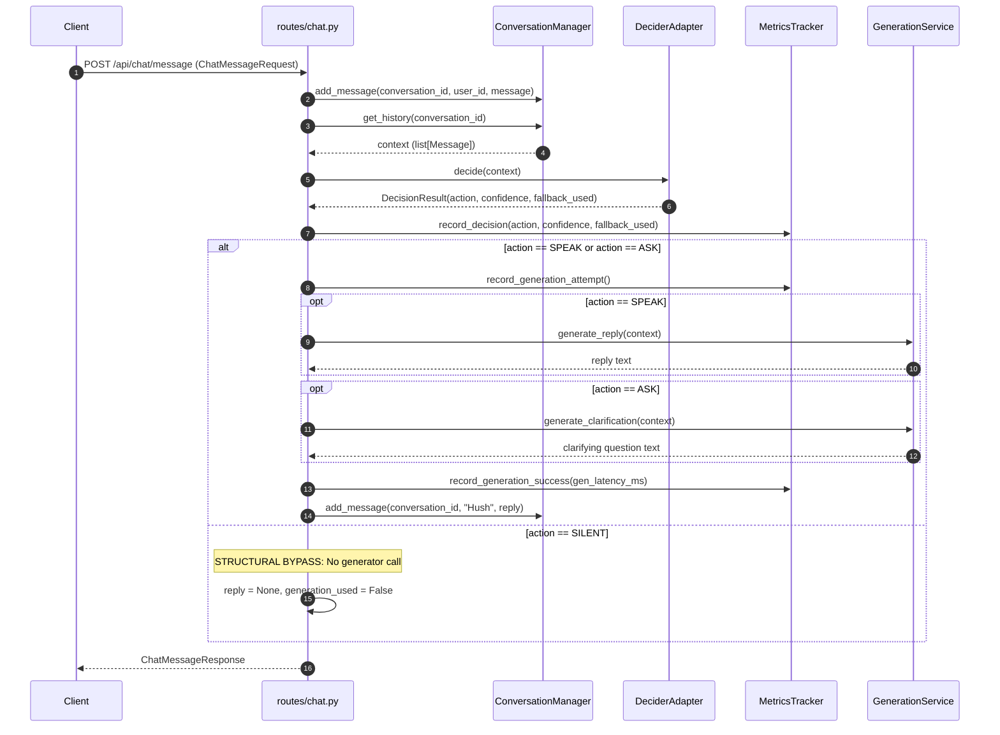

# Hush — Read-Only Repository Audit Report

## 1. Audit Baseline & Environment

- **Audit Date and Time:** 2026-10-26T23:30:00+05:30 (18:00:00 UTC)
- **Repository Root:** `C:\Users\Admin\Documents\Hush`
- **Current Git Commit Hash:** `21d29df0bb9166b529efe615da1c4ea4c272f4bf`
- **Current Git Branch:** `feature/backend-frontend`
- **Initial Git Status (`git status --short`):**
  ```text
   M PLAN.md
   M README.md
  ```
  *(Pre-existing working tree modifications present before audit commencement. No changes were staged, committed, or discarded.)*
- **Python Runtime:**
  - System Python: `3.12.7 (tags/v3.12.7:0b05ead, Oct  1 2024, 03:06:41) [MSC v.1941 64 bit (AMD64)]` at `C:\Users\Admin\AppData\Local\Programs\Python\Python312\python.exe`
  - Project Virtual Environment: Python `3.12.7` at `C:\Users\Admin\Documents\Hush\backend\.venv\Scripts\python.exe`
- **Operating System and Platform:**
  - OS: `Microsoft Windows 10 IoT Enterprise LTSC` (Version `10.0.19044`, Build `19044`, 64-bit AMD64)
  - Shell: PowerShell 5.1 / 7.x
- **Specification Status (`docs/PLAN.md` vs Root `PLAN.md`):**
  - Path `docs/PLAN.md`: **Does not exist** on disk (the `docs/` directory did not exist prior to this audit).
  - Path `PLAN.md`: **Found and readable** at the repository root (`C:\Users\Admin\Documents\Hush\PLAN.md`, 590 lines). It contains the complete flagship project specification, including Section 1 (Overview & Addressing), Section 4 (Architecture), Section 7 (Decision Policy & Reliability), Section 9 (Backend API), and Section 10 (Scope and Roadmap / Phase 1).

---

## 2. Executive Summary

Hush is envisioned as a conversational restraint engine for multi-person group chats that triages incoming messages into **SPEAK**, **ASK**, or **SILENT** prior to text generation.

A prototype backend is implemented in `backend/` using FastAPI and Pydantic v2, supported by a React/TypeScript demo frontend in `frontend/`. The existing backend represents a clean, working vertical slice of the restraint workflow:
1. **Core Invariant Verified:** When a decision evaluates to `SILENT`, text generation is completely bypassed. This behavior is enforced at three levels:
   - Route-level branch logic in [chat.py](file:///c:/Users/Admin/Documents/Hush/backend/app/routes/chat.py#L87-L91).
   - Schema-level validator in [schemas.py](file:///c:/Users/Admin/Documents/Hush/backend/app/schemas.py#L57-L65).
   - Automated test assertions with mocks in [test_api.py](file:///c:/Users/Admin/Documents/Hush/backend/tests/test_api.py#L111-L136) and [test_metrics.py](file:///c:/Users/Admin/Documents/Hush/backend/tests/test_metrics.py#L75-L91).
2. **Current Test Suite:** 38 unit and integration tests execute cleanly in 2.03 seconds with zero failures, zero errors, and zero network/cloud side effects.
3. **Primary Architecture Gaps:**
   - **Addressing and Metadata:** The prototype uses a simplified single-speaker request schema (`conversation_id`, `user_id`, `message`). It lacks speaker roles, message IDs, `mentions`, `reply_to`, and the planned two-tier addressing engine (metadata first, keyword fallback second).
   - **Confidence Semantics:** Decisions emit an uncalibrated optional float without `confidence_kind` (`calibrated_probability`, `uncalibrated_score`, `none`), risking misleading confidence representations.
   - **ML & Evaluation Infrastructure:** The `ml/` subsystem outlined in `PLAN.md` Section 11 (scenarios dataset, labeling guidelines, baselines, regularized classifier, LLM-as-decider evaluation harness, bootstrap confidence intervals) does not yet exist.
   - **CI Pipeline:** No automated GitHub Actions workflow exists in `.github/workflows/`.

**Recommended Next Action:** Do not rewrite the existing backend. Follow the incremental Phase 1 roadmap in `PLAN.md` Section 10:
1. Lock down the legacy request contract with dedicated compatibility tests.
2. Introduce the conversation-aware request schema alongside the legacy schema via an adapter layer.
3. Implement the two-tier addressing resolution engine.

---

## 3. Gap Analysis Table

The following table benchmarks the existing repository implementation against the requirements defined in `PLAN.md` (specifically Sections 1, 4, 7, 8, 9, 10, and 14).

| Requirement / Component | Status | Code Evidence (File & Line Numbers) | Recommended Action |
|---|---|---|---|
| **Speaker Identity & Message IDs** | Partially implemented | [schemas.py:18-33](file:///c:/Users/Admin/Documents/Hush/backend/app/schemas.py#L18-L33), [conversation.py:15-22](file:///c:/Users/Admin/Documents/Hush/backend/app/services/conversation.py#L15-L22) | Keep `user_id` mapped via adapter; extend message model to include `message_id`, `speaker_id`, `display_name`, `role`, and `ts`. |
| **Mentions & Reply Targets** | Missing | [schemas.py:26-33](file:///c:/Users/Admin/Documents/Hush/backend/app/schemas.py#L26-L33) (only `user_id` and `message` present) | Add `mentions: list[str]` and `reply_to: Optional[str]` to the conversation-aware schema. |
| **Two-Tier Addressing Engine** | Missing | [decider.py:38-46](file:///c:/Users/Admin/Documents/Hush/backend/app/services/decider.py#L38-L46) (only naive text substring match `"hush" in text`) | Implement Tier 1 (mentions / reply-to-Hush check) and Tier 2 (standalone name token / role request fallback); emit `address_method`. |
| **`confidence_kind` & Honest Confidence** | Missing | [schemas.py:35-43, 45-56](file:///c:/Users/Admin/Documents/Hush/backend/app/schemas.py#L35-L43) (has only `confidence: Optional[float]`) | Add `confidence_kind: Literal["calibrated_probability", "uncalibrated_score", "none"]` to `DecisionResult` and response schema. |
| **Swappable Decider Interface** | Implemented | [decider.py:13-16, 95-100](file:///c:/Users/Admin/Documents/Hush/backend/app/services/decider.py#L13-L16) (`DeciderAdapter` protocol, `get_decider` factory) | Keep protocol and factory structure; generalize context argument to support rich message history. |
| **SPEAK / ASK / SILENT Routing** | Implemented | [chat.py:50-91](file:///c:/Users/Admin/Documents/Hush/backend/app/routes/chat.py#L50-L91), [schemas.py:57-65](file:///c:/Users/Admin/Documents/Hush/backend/app/schemas.py#L57-L65) | Keep existing branch structure and Pydantic validator enforcing zero generation on SILENT. |
| **Bounded Conversation History** | Implemented | [conversation.py:8-41](file:///c:/Users/Admin/Documents/Hush/backend/app/services/conversation.py#L8-L41) (`max_history = 20`) | Keep sliding window logic; add client history seed support and thread lock safety. |
| **Legacy API Compatibility** | Partially implemented | [chat.py:16-27](file:///c:/Users/Admin/Documents/Hush/backend/app/routes/chat.py#L16-L27), [schemas.py:26-33](file:///c:/Users/Admin/Documents/Hush/backend/app/schemas.py#L26-L33) | Current endpoint serves legacy shape directly. Add request adapter so new conversation-aware payloads work seamlessly without breaking legacy clients. |
| **Telemetry & Metrics** | Partially implemented | [metrics.py:20-137](file:///c:/Users/Admin/Documents/Hush/backend/app/services/metrics.py#L20-L137), [routes/metrics.py:10-31](file:///c:/Users/Admin/Documents/Hush/backend/app/routes/metrics.py#L10-L31) | Keep counters and latency summaries; add `address_method` breakdown counter and low-confidence action policy. |
| **Structured Logging without Message Leakage** | Missing | Entire `backend/app/` has no Python logger or structlog invocations | Introduce standard structured logging that logs action, method, latency, and fallbacks without printing message text. |
| **Dataset & Evaluation Suite (`ml/`)** | Missing | Repository root contains no `ml/` directory | Create `ml/` package with `LABELING_GUIDELINE.md`, `scenarios.jsonl`, baseline runners, and bootstrap evaluation script. |
| **CI Workflow Automation** | Missing | `.github/workflows/` directory does not exist | Add GitHub Actions workflow for pytest and ruff formatting/linting. |

---

## 4. Ordered Implementation Plan

To extend the backend safely without regressing existing functionality, implement changes in four distinct sequential steps:

### Components to KEEP
- `backend/app/main.py`: Application factory, CORS settings, custom telemetry headers (`X-Hush-Decider-Mode`, `X-Hush-Generation-Mode`), and `/health` route.
- `backend/app/schemas.py`: `Action` enum, `ActionCounts`, `LatencySummary`, `MetricsResponse`, `ResetMetricsResponse`, and `validate_silent_contract` invariant validator.
- `backend/app/routes/metrics.py` & `backend/app/services/metrics.py`: In-memory thread-safe telemetry tracker and reset boundary.
- `backend/app/services/generation.py` & `backend/app/services/bedrock.py`: Text generation interfaces, AWS Bedrock client Converse wrapper, and offline development stub.
- `backend/tests/`: All 38 existing automated tests covering routes, mock Bedrock handling, metrics, and schema constraints.

### Components to EXTEND
- `backend/app/schemas.py`:
  - Extend `Message` with `message_id: str`, `speaker_id: str`, `display_name: Optional[str]`, `role: Literal["human", "assistant"]`, `mentions: list[str]`, `reply_to: Optional[str]`, `ts: Optional[float]`.
  - Add `ConversationMessagePayload` schema for modern requests.
  - Extend `ChatMessageRequest` to accept either legacy fields (`user_id`, `message`) OR nested modern `message` payload.
  - Add `confidence_kind: Literal["calibrated_probability", "uncalibrated_score", "none"]` and `address_method: str` to `DecisionResult` and `ChatMessageResponse`.
- `backend/app/services/conversation.py`:
  - Store extended `Message` objects; support pre-seeding history from client request.
- `backend/app/services/decider.py`:
  - Implement two-tier addressing resolution function (`resolve_addressing`).
  - Upgrade `DeciderAdapter` protocol and stub decider to evaluate addressing tiers and return `confidence_kind`.
- `backend/app/routes/chat.py`:
  - Add legacy adapter mapping `user_id` -> `speaker_id`, auto-generating `message_id`, and defaulting `mentions` and `reply_to` to empty lists.
- `backend/app/services/metrics.py`:
  - Track `address_method` counters (`mention`, `reply`, `name`, `request`, `none`).

### New Components Needed
- `backend/app/services/addressing.py`: Isolated two-tier addressing engine implementing Tier 1 (authoritative metadata) and Tier 2 (server-side text detection) with false-match safeguards.
- `ml/`: Subdirectory for dataset, labeling guidelines, feature extractors, and evaluation harness.
- `.github/workflows/ci.yml`: Continuous integration workflow running `pytest` and `ruff`.

### Execution Steps & Dependencies



1. **Step 1: Formalize Legacy Compatibility Tests**
   - *Dependency:* None.
   - *Action:* Add compatibility test suite validating existing `POST /api/chat/message` behavior against legacy payload.
   - *Verification:* All 38 existing tests + new compatibility tests pass.
2. **Step 2: Schema & Request Adapter Extension**
   - *Dependency:* Step 1 passing.
   - *Action:* Update `schemas.py` and `routes/chat.py` with the adapter layer.
   - *Verification:* Legacy payloads continue to return status 200 and identical response shapes; new payloads are parsed and validated.
3. **Step 3: Two-Tier Addressing Engine**
   - *Dependency:* Step 2 completed.
   - *Action:* Implement `resolve_addressing` and connect to decider pipeline.
   - *Verification:* Unit tests for addressing (mention, reply-to-Hush, human reply with "hush" in text, baby sleep false match, display name confusion).
4. **Step 4: Honest Confidence & Telemetry**
   - *Dependency:* Step 3 completed.
   - *Action:* Introduce `confidence_kind`, update response serialization, and track address methods in metrics.
   - *Verification:* Schema tests verify `confidence_kind` constraints and `GET /api/metrics` reflects method breakdown.
5. **Step 5: ML Foundations & CI**
   - *Dependency:* Backend Phase 1 complete.
   - *Action:* Create `.github/workflows/ci.yml` and `ml/` package structure.
   - *Verification:* CI runs cleanly on push.

---

## 5. Repository and Architecture Map

```text
Hush/
├── .gitignore                     # Git ignore rules for Python, venv, and Node
├── LICENSE                        # Apache 2.0 license
├── PLAN.md                        # Master project plan (Sections 1-15)
├── README.md                      # Project documentation and architectural overview
├── docs/
│   └── audit.md                   # This comprehensive audit report
├── backend/
│   ├── .env.example               # Template for configuration and AWS variables
│   ├── README.md                  # Backend setup and architectural documentation
│   ├── requirements.txt           # Production dependencies (FastAPI, Pydantic, Boto3)
│   ├── requirements-dev.txt       # Development & test dependencies (pytest, httpx, coverage)
│   ├── app/
│   │   ├── __init__.py
│   │   ├── main.py                # FastAPI app initialization, middleware, /health route
│   │   ├── config.py              # Pydantic BaseSettings configuration
│   │   ├── schemas.py             # Pydantic v2 data models, Action enum, validation rules
│   │   ├── routes/
│   │   │   ├── __init__.py
│   │   │   ├── chat.py            # POST /api/chat/message route and action execution
│   │   │   └── metrics.py         # GET /api/metrics, POST /api/metrics/reset
│   │   └── services/
│   │       ├── __init__.py
│   │       ├── bedrock.py         # Amazon Bedrock Converse API client with lazy loading
│   │       ├── conversation.py    # In-memory sliding window history manager (max 20)
│   │       ├── decider.py         # DeciderAdapter protocol, DevelopmentStubDecider, RealHushGateDecider
│   │       ├── generation.py      # GenerationService protocol and DevelopmentStubGenerator
│   │       └── metrics.py         # Thread-safe in-memory telemetry tracker
│   └── tests/
│       ├── __init__.py
│       ├── test_api.py            # End-to-end route tests, SILENT bypass, mock Bedrock
│       ├── test_bedrock.py        # Unit tests for BedrockService error wrapping & payloads
│       ├── test_metrics.py        # Telemetry counting, exclusivity, and reset tests
│       └── test_schemas.py        # Focused Pydantic schema validation tests
└── frontend/                      # React + TypeScript + Vite demo user interface
    ├── package.json
    ├── vite.config.ts
    └── src/
        ├── App.tsx                # Main UI layout with live feed and decision meters
        ├── services/api.ts        # Client API service with offline UI preview fallback
        └── types/api.ts           # TypeScript type definitions matching backend schemas
```

### Module Responsibilities

- **API Entrypoint & Middleware:** [main.py](file:///c:/Users/Admin/Documents/Hush/backend/app/main.py#L9-L47) initializes the FastAPI application, mounts CORS middleware, adds custom telemetry response headers (`X-Hush-Decider-Mode`, `X-Hush-Generation-Mode`), and exposes `GET /health`.
- **Configuration Management:** [config.py](file:///c:/Users/Admin/Documents/Hush/backend/app/config.py#L7-L37) loads environment variables using Pydantic Settings (`.env` file support, non-blocking defaults, AWS parameter placeholders).
- **Domain Schemas & Validation:** [schemas.py](file:///c:/Users/Admin/Documents/Hush/backend/app/schemas.py#L11-L111) defines strongly-typed data structures with Pydantic v2 (`extra="forbid"`), enforcing the invariant that `SILENT` actions must have `reply = None` and `generation_used = False`.
- **Chat Routing & Pipeline Orchestration:** [chat.py](file:///c:/Users/Admin/Documents/Hush/backend/app/routes/chat.py#L16-L100) coordinates state updates, decider evaluations, telemetry recording, and conditional generation invocation.
- **Telemetry & Observability:** [metrics.py](file:///c:/Users/Admin/Documents/Hush/backend/app/services/metrics.py#L20-L137) provides thread-safe counters, latency summaries, and a reset boundary, surfaced via [routes/metrics.py](file:///c:/Users/Admin/Documents/Hush/backend/app/routes/metrics.py#L10-L31).
- **Decision Engine Interface:** [decider.py](file:///c:/Users/Admin/Documents/Hush/backend/app/services/decider.py#L13-L100) provides a `DeciderAdapter` protocol, a deterministic local development stub, and a fail-fast adapter for `hush_gate`.
- **Text Generation Engine:** [generation.py](file:///c:/Users/Admin/Documents/Hush/backend/app/services/generation.py#L12-L46) defines the `GenerationService` protocol and development stub, delegating to [bedrock.py](file:///c:/Users/Admin/Documents/Hush/backend/app/services/bedrock.py#L26-L160) for AWS Bedrock Converse API operations.
- **State Management:** [conversation.py](file:///c:/Users/Admin/Documents/Hush/backend/app/services/conversation.py#L8-L41) provides an ephemeral in-memory sliding window history buffer per room.

---

## 6. API Contract and Validation

### Endpoint Inventory

#### 1. `GET /health`
- **Implementation:** [main.py:38-47](file:///c:/Users/Admin/Documents/Hush/backend/app/main.py#L38-L47)
- **Method:** `GET`
- **Request Body:** None
- **Response Schema:**
  ```json
  {
    "status": "ok",
    "mode": "stub",
    "decider_mode": "stub",
    "generation_mode": "stub",
    "environment": "development"
  }
  ```
- **Response Headers:** `X-Hush-Decider-Mode: stub`, `X-Hush-Generation-Mode: stub`
- **Error Statuses:** None.

#### 2. `POST /api/chat/message`
- **Implementation:** [chat.py:16-100](file:///c:/Users/Admin/Documents/Hush/backend/app/routes/chat.py#L16-L100)
- **Method:** `POST`
- **Request Schema (`ChatMessageRequest`):** [schemas.py:26-33](file:///c:/Users/Admin/Documents/Hush/backend/app/schemas.py#L26-L33)
  ```json
  {
    "conversation_id": "room-1",
    "user_id": "u-alex",
    "message": "Hush, what is the plan?"
  }
  ```
- **Validation Rules:**
  - `conversation_id`: string, minimum length 1, required.
  - `user_id`: string, minimum length 1, required.
  - `message`: string, minimum length 1, required.
  - `extra="forbid"`: rejects any undeclared payload fields.
- **Response Schema (`ChatMessageResponse`):** [schemas.py:45-66](file:///c:/Users/Admin/Documents/Hush/backend/app/schemas.py#L45-L66)
  ```json
  {
    "conversation_id": "room-1",
    "action": "SPEAK",
    "confidence": null,
    "reply": "[Development Stub] Generated reply addressing: 'Hush, what is the plan?'",
    "generation_used": true,
    "fallback_used": false,
    "decision_latency_ms": null
  }
  ```
- **Validation & Response Invariant:**
  - `action`: enum `["SPEAK", "SILENT", "ASK"]`.
  - `confidence`: float between `0.0` and `1.0`, or `null`.
  - When `action == "SILENT"`: `reply` MUST be `null`, and `generation_used` MUST be `false` (validated by `validate_silent_contract` in [schemas.py:57-65](file:///c:/Users/Admin/Documents/Hush/backend/app/schemas.py#L57-L65)).
- **Observed Error Responses:**
  - `422 Unprocessable Entity`: Triggered on empty string fields, missing fields, or extra payload fields.
  - `500 Internal Server Error`: Raised if Bedrock generation mode is active but AWS configuration (`AWS_REGION` or `BEDROCK_MODEL_ID`) is missing ([chat.py:74-79](file:///c:/Users/Admin/Documents/Hush/backend/app/routes/chat.py#L74-L79)).
  - `502 Bad Gateway`: Raised if AWS Bedrock Converse API invocation fails or throttles ([chat.py:80-85](file:///c:/Users/Admin/Documents/Hush/backend/app/routes/chat.py#L80-L85)).
  - `503 Service Unavailable`: Raised if real decider mode is active (`HUSH_DECIDER_MODE=real`) but the teammate `hush_gate` library is not installed or available ([chat.py:36-40](file:///c:/Users/Admin/Documents/Hush/backend/app/routes/chat.py#L36-L40)).

#### 3. `GET /api/metrics`
- **Implementation:** [routes/metrics.py:10-18](file:///c:/Users/Admin/Documents/Hush/backend/app/routes/metrics.py#L10-L18)
- **Method:** `GET`
- **Request Body:** None
- **Response Schema (`MetricsResponse`):** [schemas.py:87-104](file:///c:/Users/Admin/Documents/Hush/backend/app/schemas.py#L87-L104)
  ```json
  {
    "messages_evaluated": 0,
    "decisions": {
      "SPEAK": 0,
      "SILENT": 0,
      "ASK": 0
    },
    "fallback_decisions": 0,
    "low_confidence_decisions": 0,
    "generation_calls_attempted": 0,
    "generation_calls_succeeded": 0,
    "generation_calls_failed": 0,
    "generation_calls_avoided": 0,
    "call_reduction_rate_pct": 0.0,
    "decision_latency": {
      "count": 0,
      "avg_ms": null,
      "min_ms": null,
      "max_ms": null
    },
    "generation_latency": {
      "count": 0,
      "avg_ms": null,
      "min_ms": null,
      "max_ms": null
    },
    "decider_mode": "stub",
    "generation_mode": "stub"
  }
  ```
- **Error Statuses:** None.

#### 4. `POST /api/metrics/reset`
- **Implementation:** [routes/metrics.py:20-31](file:///c:/Users/Admin/Documents/Hush/backend/app/routes/metrics.py#L20-L31)
- **Method:** `POST`
- **Request Body:** None
- **Response Schema (`ResetMetricsResponse`):** [schemas.py:106-111](file:///c:/Users/Admin/Documents/Hush/backend/app/schemas.py#L106-L111)
  ```json
  {
    "status": "ok",
    "message": "Metrics reset successfully"
  }
  ```
- **Error Statuses:** None.

---

## 7. Decision/Generation Flow and Conversation History

### Trace of Request Execution



### Can SILENT Call Generation?

**No. SILENT cannot and does not call the generation service.**
- **Static Code Evidence:**
  1. In [chat.py:55-86](file:///c:/Users/Admin/Documents/Hush/backend/app/routes/chat.py#L55-L86), generator calls are strictly enclosed inside the block `if decision.action in (Action.SPEAK, Action.ASK):`.
  2. In [chat.py:87-90](file:///c:/Users/Admin/Documents/Hush/backend/app/routes/chat.py#L87-L90), the `Action.SILENT` branch explicitly enforces:
     ```python
     elif decision.action == Action.SILENT:
         # INVARIANT: When SILENT, reply is strictly None and generation is never called.
         reply = None
         generation_used = False
     ```
  3. In [schemas.py:57-65](file:///c:/Users/Admin/Documents/Hush/backend/app/schemas.py#L57-L65), the `ChatMessageResponse` model validator raises a `ValueError` if `action == Action.SILENT` and either `generation_used` is `True` or `reply` is not `None`.
- **Test Evidence (Observed):**
  1. [test_api.py:111-136](file:///c:/Users/Admin/Documents/Hush/backend/tests/test_api.py#L111-L136) (`test_critical_silent_makes_zero_generation_calls`) patches `get_generator` with a `MagicMock()` and asserts `mock_gen.generate_reply.call_count == 0` and `mock_gen.generate_clarification.call_count == 0`. This test executed and **PASSED**.
  2. [test_api.py:182-205](file:///c:/Users/Admin/Documents/Hush/backend/tests/test_api.py#L182-L205) (`test_bedrock_mode_silent_strictly_never_calls_bedrock`) patches Bedrock mode with a `MagicMock()` and confirms zero calls. This test executed and **PASSED**.
  3. [test_metrics.py:75-91](file:///c:/Users/Admin/Documents/Hush/backend/tests/test_metrics.py#L75-L91) confirms that on a `SILENT` decision, `generation_calls_attempted` remains unchanged and `generation_calls_avoided` increments by 1. This test executed and **PASSED**.

### Conversation History Representation and Boundaries

- **Representation:** History is stored as a list of `Message` instances (`speaker: str`, `text: str`) in [schemas.py:18-24](file:///c:/Users/Admin/Documents/Hush/backend/app/schemas.py#L18-L24).
- **Storage:** In-memory dictionary `defaultdict(list)` indexed by `conversation_id` in [conversation.py:8-41](file:///c:/Users/Admin/Documents/Hush/backend/app/services/conversation.py#L8-L41).
- **Bounding:** The sliding window is capped at `max_history = 20`. When the message count exceeds `max_history`, older messages are pruned: `history[-self.max_history:]` ([conversation.py:20-21](file:///c:/Users/Admin/Documents/Hush/backend/app/services/conversation.py#L20-L21)).
- **Reset Boundary:** History can be cleared per conversation via `clear(conversation_id)` or globally via `clear_all()` ([conversation.py:31-39](file:///c:/Users/Admin/Documents/Hush/backend/app/services/conversation.py#L31-L39)).
- **Limitations & Isolation Risks:**
  - *Process Ephemerality:* Data resides purely in RAM and is lost upon process restart.
  - *Unbounded Memory Growth:* The dictionary creates entries for every unique `conversation_id` with no TTL or eviction policy, creating a memory leak risk under high traffic with distinct room IDs.
  - *Concurrency Safety:* Unlike `MetricsTracker`, `ConversationManager` lacks a thread lock (`threading.Lock`), presenting potential race conditions during concurrent appends in multi-threaded Uvicorn workers.
  - *Context Seed Capability:* There is currently no endpoint parameter permitting the client to seed conversation history (required for scenario replay and evaluation per `PLAN.md` Section 9).

---

## 8. Metrics, Logging, Error Handling, and Fallbacks

### Metrics Telemetry

- **Endpoints:** `GET /api/metrics` and `POST /api/metrics/reset` ([routes/metrics.py:10-31](file:///c:/Users/Admin/Documents/Hush/backend/app/routes/metrics.py#L10-L31)).
- **Metrics Collected:**
  - `messages_evaluated`: Total chat evaluations.
  - `decisions`: Mutually exclusive counts for `SPEAK`, `SILENT`, `ASK`.
  - `fallback_decisions`: Decisions where fallback rules applied.
  - `low_confidence_decisions`: Decisions with confidence below threshold (`0.60`).
  - `generation_calls_attempted`, `generation_calls_succeeded`, `generation_calls_failed`.
  - `generation_calls_avoided`: Total `SILENT` actions.
  - `call_reduction_rate_pct`: Percentage of calls avoided vs. an always-reply policy.
  - `decision_latency`, `generation_latency`: Count, min, max, average ms.
- **Missing Metrics:** `PLAN.md` Section 9 specifies tracking `address_method` counts (`mention`, `reply`, `name`, `request`, `none`). This counter is currently **not found**.

### Logging Review

- **Message Content Privacy:** Neither the application entry point nor any service module logs incoming or outgoing message text. Standard Uvicorn HTTP access logging outputs endpoint URLs, HTTP methods, and status codes, but does not print request or response bodies.
- **Finding:** Message text privacy is preserved, but application-level structured logging (recording decisions, action choices, and latencies without payload text) is **missing**.

### Error Handling & Fallbacks

- **Decider Unavailable:**
  - If `HUSH_DECIDER_MODE="real"` and `hush_gate` cannot be imported, [decider.py:74-81](file:///c:/Users/Admin/Documents/Hush/backend/app/services/decider.py#L74-L81) raises `RuntimeError`, which [chat.py:36-40](file:///c:/Users/Admin/Documents/Hush/backend/app/routes/chat.py#L36-L40) converts into an HTTP `503 Service Unavailable`.
  - In `stub` mode, fallback heuristics never raise exceptions.
- **Bedrock Failures:**
  - Missing credentials/region/model ID raises `BedrockConfigError` -> HTTP `500 Internal Server Error` ([chat.py:74-79](file:///c:/Users/Admin/Documents/Hush/backend/app/routes/chat.py#L74-L79)).
  - Boto3 ClientError, throttling, or network timeout raises `BedrockServiceError` -> HTTP `502 Bad Gateway` ([chat.py:80-85](file:///c:/Users/Admin/Documents/Hush/backend/app/routes/chat.py#L80-L85)).
  - When generation fails, `metrics_tracker.record_generation_failure()` increments `generation_calls_failed` ([test_metrics.py:149-168](file:///c:/Users/Admin/Documents/Hush/backend/tests/test_metrics.py#L149-L168)).
- **Low Confidence & Fallback Safeguards:**
  - `PLAN.md` Section 7 specifies: *low confidence -> SILENT unless addressed; addressed + low confidence -> ASK; service failure -> SILENT unless addressed, logged*.
  - **Finding:** This policy is **missing** from the current prototype. The backend records `low_confidence_decisions` in metrics ([metrics.py:68-69](file:///c:/Users/Admin/Documents/Hush/backend/app/services/metrics.py#L68-L69)), but does not modify the decider's action routing.

---

## 9. Secret-Handling Review

- **Configuration & Environment Variables:**
  - In [config.py:7-13](file:///c:/Users/Admin/Documents/Hush/backend/app/config.py#L7-L13), `Settings` uses Pydantic's `SettingsConfigDict` reading from `.env`.
  - Secrets are never hardcoded. AWS parameters default to `None` ([config.py:26-28](file:///c:/Users/Admin/Documents/Hush/backend/app/config.py#L26-L28)).
- **Git Ignore Safeguards:**
  - Root [.gitignore:36-40](file:///c:/Users/Admin/Documents/Hush/.gitignore#L36-L40) explicitly ignores `.env` and `.env*.local`, while keeping `!.env.example` tracked.
- **Tracked Files & Examples:**
  - `backend/.env.example` contains only empty placeholder keys (`AWS_REGION=`, `BEDROCK_MODEL_ID=`, `AWS_ACCESS_KEY_ID=`, etc.).
  - A full repository search confirms that no `.env` file exists on disk, and no credentials or secret keys are present in tracked files or Git history.
- **Exposure Risk:** **None detected.**

---

## 10. Test Suite Results and Safety Verification

### Pre-Execution Safety Inspection

Prior to execution, all four test files were audited line-by-line:
1. `backend/tests/test_api.py`: Uses FastAPI `TestClient` in-memory. In Bedrock tests, `get_generator` is patched with `MagicMock()`. Real decider test patches `RealHushGateDecider`, catching expected `ImportError`. All state is reset before and after each test. **Safe.**
2. `backend/tests/test_bedrock.py`: Explicitly documented `Tests MUST NOT make real AWS calls.` Instantiates `BedrockService` with `client=mock_client` (MagicMock) or tests missing config which raises errors prior to client creation. **Safe.**
3. `backend/tests/test_metrics.py`: In-memory tests using `TestClient` with mocks. Resets state via fixture. **Safe.**
4. `backend/tests/test_schemas.py`: Pure in-memory Pydantic validation tests. **Safe.**

No tests make external network calls, invoke real LLM/AWS APIs, read private `.env` files, or write to disk.

### Test Execution Command and Results

- **Environment:** Windows PowerShell
- **Exact Command Executed:**
  ```powershell
  $env:PYTHONDONTWRITEBYTECODE="1"; $env:PYTHONPATH="backend"; & .\backend\.venv\Scripts\python.exe -m pytest backend/tests -p no:cacheprovider -v
  ```
- **Observed Test Run Output:**
  ```text
  ============================= test session starts =============================
  platform win32 -- Python 3.12.7, pytest-9.1.1, pluggy-1.7.0 -- C:\Users\Admin\Documents\Hush\backend\.venv\Scripts\python.exe
  rootdir: C:\Users\Admin\Documents\Hush
  plugins: anyio-4.15.1, asyncio-1.4.0, cov-7.1.0
  asyncio: mode=Mode.STRICT, debug=False, asyncio_default_fixture_loop_scope=None, asyncio_default_test_loop_scope=function
  collecting ... collected 38 items

  backend/tests/test_api.py::test_health_check_endpoint PASSED             [  2%]
  backend/tests/test_api.py::test_chat_message_speak_action_stub_mode PASSED [  5%]
  backend/tests/test_api.py::test_chat_message_ask_action_stub_mode PASSED [  7%]
  backend/tests/test_api.py::test_chat_message_silent_action_stub_mode PASSED [ 10%]
  backend/tests/test_api.py::test_critical_silent_makes_zero_generation_calls PASSED [ 13%]
  backend/tests/test_api.py::test_bedrock_mode_routes_speak_to_generate_reply PASSED [ 15%]
  backend/tests/test_api.py::test_bedrock_mode_routes_ask_to_generate_clarification PASSED [ 18%]
  backend/tests/test_api.py::test_bedrock_mode_silent_strictly_never_calls_bedrock PASSED [ 21%]
  backend/tests/test_api.py::test_bedrock_missing_configuration_fails_with_500 PASSED [ 23%]
  backend/tests/test_api.py::test_bedrock_service_error_fails_with_502 PASSED [ 26%]
  backend/tests/test_api.py::test_real_decider_mode_fails_clearly_when_hush_gate_unavailable PASSED [ 28%]
  backend/tests/test_api.py::test_bounded_conversation_history PASSED      [ 31%]
  backend/tests/test_bedrock.py::test_missing_region_raises_config_error PASSED [ 34%]
  backend/tests/test_bedrock.py::test_missing_model_id_raises_config_error PASSED [ 36%]
  backend/tests/test_bedrock.py::test_generate_reply_calls_converse_with_expected_payload PASSED [ 39%]
  backend/tests/test_bedrock.py::test_generate_clarification_calls_converse_with_expected_payload PASSED [ 42%]
  backend/tests/test_bedrock.py::test_client_error_wrapped_into_bedrock_service_error PASSED [ 44%]
  backend/tests/test_bedrock.py::test_network_connection_error_wrapped PASSED [ 47%]
  backend/tests/test_bedrock.py::test_empty_content_blocks_raises_service_error PASSED [ 50%]
  backend/tests/test_metrics.py::test_metrics_initial_state PASSED         [ 52%]
  backend/tests/test_metrics.py::test_metrics_updated_on_chat_messages_with_category_exclusivity PASSED [ 55%]
  backend/tests/test_metrics.py::test_metrics_reset_endpoint PASSED        [ 57%]
  backend/tests/test_metrics.py::test_generation_failure_updates_failed_counter PASSED [ 60%]
  backend/tests/test_metrics.py::test_health_checks_and_resets_do_not_pollute_metrics PASSED [ 63%]
  backend/tests/test_schemas.py::test_action_enum_values PASSED            [ 65%]
  backend/tests/test_schemas.py::test_action_enum_invalid PASSED           [ 68%]
  backend/tests/test_schemas.py::test_chat_message_request_valid PASSED    [ 71%]
  backend/tests/test_schemas.py::test_chat_message_request_rejects_empty_and_extra_fields PASSED [ 73%]
  backend/tests/test_decision_result_valid PASSED                         [ 76%]
  backend/tests/test_schemas.py::test_decision_result_confidence_bounds PASSED [ 78%]
  backend/tests/test_schemas.py::test_decision_result_confidence_none PASSED [ 81%]
  backend/tests/test_schemas.py::test_chat_message_response_speak_valid PASSED [ 84%]
  backend/tests/test_schemas.py::test_chat_message_response_ask_valid PASSED [ 86%]
  backend/tests/test_schemas.py::test_chat_message_response_silent_valid PASSED [ 89%]
  backend/tests/test_schemas.py::test_chat_message_response_silent_rejects_generation_used PASSED [ 92%]
  backend/tests/test_schemas.py::test_chat_message_response_silent_rejects_non_null_reply PASSED [ 94%]
  backend/tests/test_schemas.py::test_chat_message_response_confidence_none PASSED [ 97%]
  backend/tests/test_schemas.py::test_message_valid PASSED                 [100%]

  ============================== warnings summary ===============================
  backend\.venv\Lib\site-packages\fastapi\testclient.py:1
    StarletteDeprecationWarning: Using `httpx` with `starlette.testclient` is deprecated; install `httpx2` instead.
  ======================== 38 passed, 1 warning in 2.03s ========================
  ```
- **Summary Counts:**
  - **Passed:** 38
  - **Failed:** 0
  - **Errors:** 0
  - **Skipped:** 0
  - **Warnings:** 1 (Starlette deprecation warning regarding TestClient httpx import)
- **Artifacts Created by Test Run:** None. Git status was verified before and after execution; no new files or cache directories were generated.

---

## 11. Proposed Compatibility Test Code

Per Section 11 of the audit instructions, the following compatibility test suite must be integrated into `backend/tests/` **before** any schema modifications occur in Phase 1.

> [!IMPORTANT]
> The code below is proposed specification code only. In strict compliance with read-only instructions, this test code has not been written to any test file or executed during this audit.

```python
"""Proposed compatibility tests for legacy chat request shape.

Validates:
- Successful legacy requests with (conversation_id, user_id, message)
- SPEAK / ASK / SILENT routing under legacy payloads
- Strict invariant that SILENT makes zero generation calls
- Legacy response contract matching ChatMessageResponse
- Validation rejection of missing fields, empty strings, and extra fields
"""

from unittest.mock import MagicMock, patch
import pytest
from fastapi.testclient import TestClient

from app.main import app
from app.schemas import Action
from app.services.conversation import conversation_manager
from app.services.metrics import metrics_tracker

client = TestClient(app)


@pytest.fixture(autouse=True)
def reset_state():
    """Ensure in-memory history and metrics are clean before and after each test."""
    conversation_manager.clear_all()
    metrics_tracker.reset()
    yield
    conversation_manager.clear_all()
    metrics_tracker.reset()


def test_legacy_request_speak_routing():
    """Legacy request addressing Hush routes to SPEAK and returns generated text."""
    payload = {
        "conversation_id": "legacy-room-1",
        "user_id": "user-alex",
        "message": "Hush, what is the plan for deployment?",
    }
    response = client.post("/api/chat/message", json=payload)
    assert response.status_code == 200
    data = response.json()

    assert data["conversation_id"] == "legacy-room-1"
    assert data["action"] == "SPEAK"
    assert data["generation_used"] is True
    assert data["reply"] is not None
    assert "[Development Stub]" in data["reply"]
    assert data["fallback_used"] is False


def test_legacy_request_ask_routing():
    """Legacy request with a general question routes to ASK and returns clarification."""
    payload = {
        "conversation_id": "legacy-room-1",
        "user_id": "user-sam",
        "message": "The pipeline is failing. Can anyone help?",
    }
    response = client.post("/api/chat/message", json=payload)
    assert response.status_code == 200
    data = response.json()

    assert data["conversation_id"] == "legacy-room-1"
    assert data["action"] == "ASK"
    assert data["generation_used"] is True
    assert data["reply"] is not None
    assert "[Development Stub]" in data["reply"]


def test_legacy_request_silent_routing():
    """Legacy banter message routes to SILENT with null reply and generation_used=False."""
    payload = {
        "conversation_id": "legacy-room-1",
        "user_id": "user-taylor",
        "message": "Grabbing a cup of coffee.",
    }
    response = client.post("/api/chat/message", json=payload)
    assert response.status_code == 200
    data = response.json()

    assert data["conversation_id"] == "legacy-room-1"
    assert data["action"] == "SILENT"
    assert data["generation_used"] is False
    assert data["reply"] is None


def test_legacy_request_silent_strictly_never_invokes_generator():
    """Verify generator is never invoked on SILENT when using legacy request shape."""
    mock_generator = MagicMock()
    with patch("app.routes.chat.get_generator", return_value=mock_generator):
        payload = {
            "conversation_id": "legacy-silent-verify",
            "user_id": "user-jordan",
            "message": "Sounds good, talk later.",
        }
        response = client.post("/api/chat/message", json=payload)
        assert response.status_code == 200
        data = response.json()

        assert data["action"] == "SILENT"
        assert data["generation_used"] is False
        assert data["reply"] is None

        mock_generator.generate_reply.assert_not_called()
        mock_generator.generate_clarification.assert_not_called()
        assert mock_generator.generate_reply.call_count == 0
        assert mock_generator.generate_clarification.call_count == 0


def test_legacy_response_contract_fields():
    """Verify legacy response strictly includes all required fields with expected types."""
    payload = {
        "conversation_id": "contract-test-room",
        "user_id": "user-1",
        "message": "Hello Hush!",
    }
    response = client.post("/api/chat/message", json=payload)
    assert response.status_code == 200
    data = response.json()

    expected_keys = {
        "conversation_id",
        "action",
        "confidence",
        "reply",
        "generation_used",
        "fallback_used",
        "decision_latency_ms",
    }
    assert set(data.keys()) == expected_keys
    assert isinstance(data["conversation_id"], str)
    assert data["action"] in {"SPEAK", "SILENT", "ASK"}
    assert isinstance(data["generation_used"], bool)
    assert isinstance(data["fallback_used"], bool)


def test_legacy_request_validation_rejections():
    """Verify 422 rejections for missing fields, empty strings, and extra fields."""
    # 1. Missing required field 'message'
    resp1 = client.post("/api/chat/message", json={
        "conversation_id": "c1",
        "user_id": "u1",
    })
    assert resp1.status_code == 422

    # 2. Empty string for 'conversation_id'
    resp2 = client.post("/api/chat/message", json={
        "conversation_id": "",
        "user_id": "u1",
        "message": "hello",
    })
    assert resp2.status_code == 422

    # 3. Empty string for 'message'
    resp3 = client.post("/api/chat/message", json={
        "conversation_id": "c1",
        "user_id": "u1",
        "message": "",
    })
    assert resp3.status_code == 422

    # 4. Extra unexpected field rejected by extra="forbid"
    resp4 = client.post("/api/chat/message", json={
        "conversation_id": "c1",
        "user_id": "u1",
        "message": "hello",
        "unknown_extra": "rejected",
    })
    assert resp4.status_code == 422
```

---

## 12. Detailed Findings and Unresolved Questions

### Fact vs. Inference vs. Unknown

1. **Verified Facts (Code and Test Verified):**
   - The backend runs on FastAPI with Pydantic v2 schemas configured with `extra="forbid"`.
   - The SILENT invariant is strictly enforced: `reply` is `None` and `generation_used` is `False`. Generator mocks confirm zero calls on SILENT.
   - All 38 existing automated tests execute and pass without requiring external services or cloud credentials.
   - In-memory metrics tracking correctly enforces category exclusivity across `SPEAK`, `SILENT`, and `ASK`.
   - `docs/PLAN.md` is absent, while `PLAN.md` exists at repository root and defines the full architecture and roadmap.
2. **Inferences:**
   - The `DevelopmentStubDecider` keyword check (`"hush" in latest_text`) is a placeholder for development, as real group-chat addressing requires the authoritative metadata checks specified in Section 1.
   - The frontend's `SAMPLE_SCENARIOS` array and `isLive` fallback logic in `frontend/src/services/api.ts` were designed to allow UI development to proceed independently before backend ML integration.
3. **Unresolved Questions:**
   - *Dual-Schema Routing Strategy:* Does the user prefer handling the new conversation-aware schema on the existing `POST /api/chat/message` endpoint via a union schema/adapter, or versioning the endpoint (e.g., `POST /api/v1/chat/message`) while retaining the unversioned route for legacy clients?
   - *Decider Packaging:* Will the ML deciders (logistic regression, embedding classifier, LLM baseline) be co-located inside the `backend/` service or packaged inside the planned `ml/` package and imported into `backend/app/services/decider.py`?
   - *Pre-Seeded History Lifecycle:* When clients supply `history` in `POST /api/chat/message` (as specified in Section 9), should that history overwrite in-memory state for that `conversation_id`, or be merged ephemerally for the evaluation turn?
