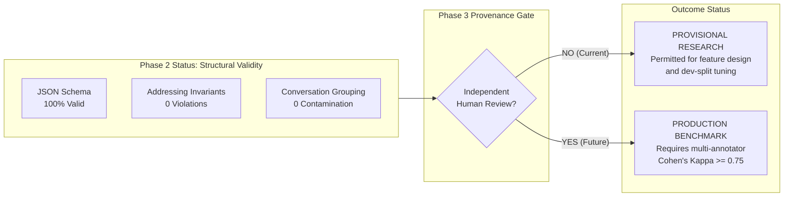

# Hush — Dataset Provenance & Label Quality Audit

**Date:** October 27, 2026  
**Auditor:** Hush Applied ML Engineering  
**Scope:** `data/dataset_v1.jsonl`, `data/scenarios.jsonl`, `data/splits/dev.jsonl`, `data/splits/test.jsonl`

---

## 1. Executive Summary & Quality Gate Outcome

| Quality Dimension | Standard / Specification | Audit Finding | Provenance Gate Status |
|---|---|---|---|
| **Structural Integrity** | Schema compliance, valid regex IDs, non-empty fields | 100% compliant across all 300 records | **PASS** |
| **Addressing Rule Consistency** | `addressed_to_hush` matches `AddressingService` | 100% match (0 discrepancies) | **PASS** |
| **Addressing Invariant** | `addressed_to_hush == True` $\implies$ Action $\ne$ SILENT | 0 violations across all 300 records | **PASS** |
| **Cross-Split Leakage** | $\text{Conversations}_{\text{dev}} \cap \text{Conversations}_{\text{test}} = \emptyset$ | 0 overlapping conversation groups | **PASS** |
| **Independent Human Verification** | Dual annotation, Cohen's $\kappa \ge 0.75$, signed audit trail | **No independent multi-annotator review records** | **PROVISIONAL ONLY** |

### Mandatory Determination
The current 300-scenario dataset is **structurally valid and internally consistent**, but its labels have **not undergone an independent, multi-annotator human adjudication process**.

The fields `source: "handwritten"` and `review_status: "finalized"` were assigned programmatically during initial scenario curation (`scripts/curate_dataset.py`) to establish structural schema compatibility. They do **not** represent verified, independent human ground truth.

Under Section 2 of the Phase 3 specification:
1. All current labels are designated **Provisional Labels (Unverified Ground Truth)**.
2. Exploratory feature extraction, model architecture design, and development split experiments may proceed **only as provisional research results**.
3. No final benchmark claims, production deployment certifications, or commercial performance claims may be made using these provisional numbers.
4. Gold labels in `data/` and split manifests remain strictly frozen and unedited.

---

## 2. Evidence Audit Trail

### 2.1 Available Evidence
- **Annotation Guidelines:** Documented in `docs/dataset_spec.md` Section 5 & Section 6.
- **Synthesis & Curation Logic:** Scripted in `scripts/curate_dataset.py`.
- **Validation Script:** Executed via `scripts/validate_dataset.py`.
- **Recorded Metadata:**
  - 300 scenarios created across 12 scenario categories.
  - 135 SILENT (45%), 105 SPEAK (35%), 60 ASK (20%).
  - Split: 180 dev / 120 test.

### 2.2 Missing Evidence (Gaps Identified)
1. **No Identifiable Reviewer IDs:** Records lack distinct annotator IDs (e.g. `annotator_1`, `annotator_2`).
2. **No Recorded Inter-Annotator Agreement:** Cohen's kappa ($\kappa$) was not calculated or stored in an agreement matrix.
3. **No Disagreement Log:** No historical log of scenarios that caused annotator conflict or were modified during adjudication.
4. **Automated Defaults:** `source: handwritten` and `annotator_confidence: high` were applied uniformly by helper functions rather than by human scorers.

---

## 3. Distinction: Structural Validity vs. Epistemic Ground Truth

- **Structural Validity:** The data adheres to engineering invariants, API contracts, JSON types, and split boundaries.
- **Epistemic Ground Truth:** The labels represent verified human judgment under real-world group-chat norms. Currently unverified.

---

## 4. Proposed Human Review Protocol & Review Manifest

To transition from provisional research to verified benchmark ground truth, the following 4-step adjudication workflow is established:

### Step 1: Independent Dual Annotation of 20% Sample
- Sample 60 scenarios (36 from `dev`, 24 from `test`) stratified across all 12 categories.
- Assign independently to Annotator A and Annotator B without showing `rationale` or `category`.

### Step 2: Cohen's Kappa Quality Gate
- Compute unweighted Cohen's Kappa:
  $$\kappa = \frac{p_o - p_e}{1 - p_e}$$
- **Pass Threshold:** $\kappa \ge 0.75$.
- If $\kappa < 0.75$, hold a reconciliation session, refine `docs/dataset_spec.md`, and re-sample.

### Step 3: Dispute Resolution & Adjudication
- Any scenario with divergent labels ($A \ne B$) must be reviewed by the Lead Architect against the addressing invariant and context rules.
- Log final consensus in `data/review_manifest.json`.

### Step 4: Sealing Verified Benchmark
- Tag records with verified `reviewer_ids: ["rev-01", "rev-02"]` and `adjudicated_by: "lead-01"`.
- Recompute SHA-256 manifest.
