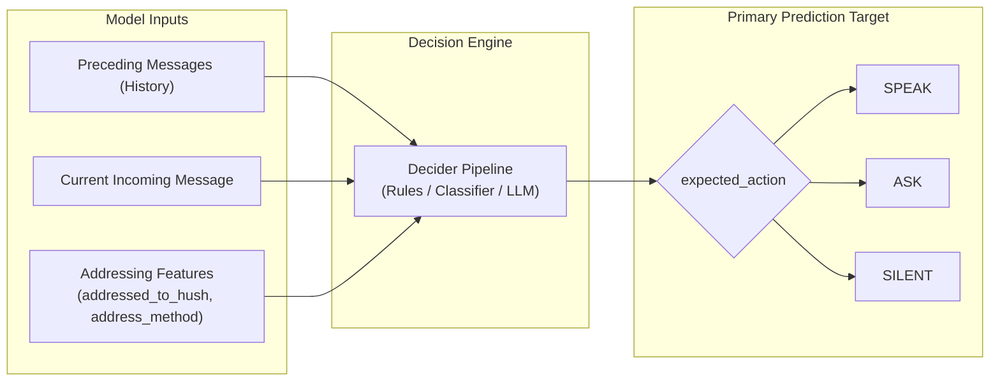
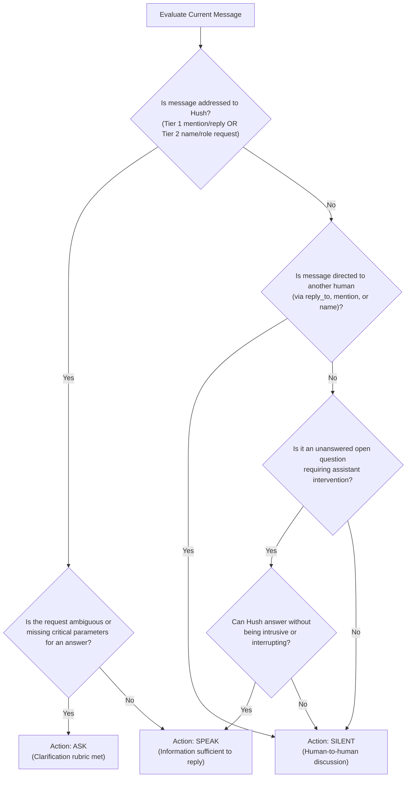
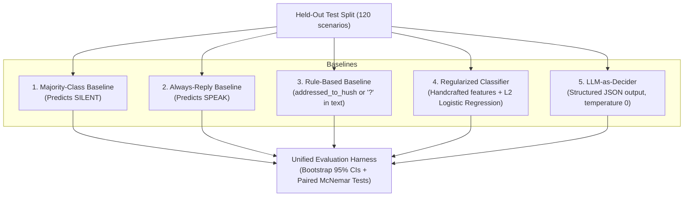

# Hush — Phase 2, Step 1: Dataset Specification & Labeling Rules

> **Status:** Specification Draft  
> **Author:** Applied ML & Software Engineering  
> **Date:** October 2026  
> **Governing Document:** [`docs/PLAN.md`](file:///c:/Users/Admin/Documents/Hush/docs/PLAN.md) (Sections 1, 6, 7, 8, 9, and 10)  
> **Output Dataset File (Target for Step 2):** `data/scenarios.jsonl`

---

## 1. Purpose and Scope

Hush is a **Conversational Restraint Engine** for multi-party group chats. Before invoking any large language model or generating text, Hush decides among three mutually exclusive actions:
- `SPEAK`: Post a full response.
- `ASK`: Post a single targeted clarifying question.
- `SILENT`: Remain quiet with zero generator calls.

This document establishes the official dataset specification, record schema, annotation rules, and evaluation protocol for Phase 2. It ensures that downstream experiments comparing rule-based deciders, regularized machine-learning classifiers, and LLM-as-decider systems are:
1. **Statistically honest:** Acknowledging sample-size limitations and reporting confidence intervals.
2. **Leakage-free:** Splitting by conversation thread rather than isolated messages.
3. **Reproducible:** Providing fixed schemas, deterministic splits, and frozen evaluation scenarios.

> [!IMPORTANT]
> **Specification Scope Only:** This document defines the protocol and schema. It does not generate data, train models, or alter production runtime code.

---

## 2. Requirements Extracted from `docs/PLAN.md`

The authoritative requirements from [`docs/PLAN.md`](file:///c:/Users/Admin/Documents/Hush/docs/PLAN.md) governing the dataset and evaluation are:

| Requirement Area | Specification in `docs/PLAN.md` | Section Reference |
|---|---|---|
| **Target Dataset Size** | Initial target of **~300 labeled scenarios**. Sufficient for an initial baseline experiment; headline comparisons within noise require expanding the dataset. | Section 8.1 |
| **Split Proportions** | **~60% development (~180 scenarios) / ~40% held-out test (~120 scenarios)**. | Section 8.1 |
| **Split Isolation** | **Split strictly by conversation (`conversation_id`)**, never by individual message, to prevent history and speaker leakage. | Section 8.1, 8.4 |
| **Test Set Discipline** | The test set is evaluated **once** for reported numbers. No hyperparameter tuning, prompt iteration, or threshold fitting on test. | Section 8.1, 8.7 |
| **Action Labels** | Exactly three mutually exclusive actions: `SPEAK`, `ASK`, `SILENT`. | Section 1, 7, 8.3 |
| **Addressing Engine** | Two-tier addressing policy: Tier 1 (mentions, reply targets) and Tier 2 (server-side name invocation, direct role requests). | Section 1 |
| **Addressing Ground Truth** | `addressed_to_hush` and `address_method` must be **derived from the Section 1 rule and validated with a script**, not hand-labeled arbitrarily. Annotators hand-label only `expected_action`. | Section 8.4 |
| **Scenario Categories** | 12 explicit categories: direct questions/requests, statements needing no response, venting/emotional messages, casual banter, human-to-human questions, ambiguous messages, history-dependent follow-ups, repeated messages, messages addressed to the assistant, clarification-worthy requests, already-answered questions, empty/malformed/oversized inputs. | Section 8.2 |
| **Baselines** | Five evaluation systems: Majority-class, Always-reply, Rule-based decider, Small regularized classifier (handcrafted features + embeddings ablation), and LLM-as-decider. | Section 6, 8.5 |
| **Evaluation Metrics** | Macro-F1, per-class Precision/Recall/F1, Confusion Matrix, Unnecessary Response Rate, Missed Contribution Rate, Generation Calls Avoided (vs. Always-Reply), and Decision Latency (median & p95). | Section 8.5 |
| **Statistical Analysis** | Bootstrap 95% confidence intervals and paired hypothesis testing (paired bootstrap or McNemar). At $N \approx 120$ test scenarios, the confidence interval is roughly $\pm 7$ points; differences within that band must not be claimed as significant. | Section 8.5 |

### Requirements Gap Analysis & Recommendations

| Item | Status in `PLAN.md` | Identified Gap / Ambiguity | Recommendation (This Specification) |
|---|---|---|---|
| **Gold Addressing vs. Model Input** | Ambiguous | Is `addressed_to_hush` a feature input to ML models, or a separate target? | In production, addressing runs first via [`AddressingService`](file:///c:/Users/Admin/Documents/Hush/backend/app/services/addressing.py). For the dataset, `addressed_to_hush` and `address_method` are recorded as deterministic features available to deciders. |
| **Data Provenance** | Partially specified | Recommends mix of hand-written, LLM-generated + reviewed, and dialogue corpora. | Add explicit `source` metadata field (`handwritten`, `llm_generated_reviewed`, `corpus_adapted`) to ensure provenance auditing. |
| **Annotator Agreement** | Recommends check | Suggests Cohen's $\kappa$ on ~20% subset. | Standardize protocol: 60 scenarios (20%) dual-labeled; require Cohen's $\kappa \ge 0.75$ before releasing `data/scenarios.jsonl`. |

---

## 3. Definition of Prediction Target & Model Inputs

### 3.1 Primary Prediction Target
The primary target of the Hush decision engine is:
$$\mathbf{y} \in \{\text{SPEAK}, \text{ASK}, \text{SILENT}\}$$

The dataset records this under the key **`expected_action`**.

### 3.2 Separation of Addressing and Decision Policy
Hush explicitly separates conversational mechanics (addressing) from conversational restraint (action decision):
1. **Addressing (`addressed_to_hush: bool`, `address_method: AddressMethod`):**
   - Computed deterministically by the Two-Tier addressing engine ([`backend/app/services/addressing.py`](file:///c:/Users/Admin/Documents/Hush/backend/app/services/addressing.py)).
   - Represents the physical/structural routing of the message in the group chat.
2. **Decision Action (`expected_action`):**
   - Decided by the decision engine (`RuleBasedDecider`, `ClassifierDecider`, or `LLMDecider`).
   - Represents behavioral judgment: *Even if addressed, is an answer possible without clarification? Even if unaddressed, is there an open crisis where help is urgently needed?*



> [!CAUTION]
> **Addressing Invariant Guardrail:** Per Section 7 of `docs/PLAN.md`, a message explicitly addressed to Hush or directly requesting Hush's help must **never be silently ignored**. Therefore, if `addressed_to_hush == True`, `expected_action` must be either `SPEAK` or `ASK`. It can only be `SILENT` if the message is unaddressed or if it is an empty/invalid transmission.

### 3.3 Inference-Time Inputs vs. Annotation Metadata
To prevent label leakage during training and feature extraction, dataset fields are strictly partitioned:

| Category | Field Names | Available to Feature Extractor / Decider? |
|---|---|---|
| **Scenario Metadata** | `id`, `conversation_id`, `category` | **No** (Leakage risk: category reveals target intent) |
| **Model Context Inputs** | `participants`, `messages` (history + latest) | **Yes** |
| **Addressing Signals** | `addressed_to_hush`, `address_method` | **Yes** (Derived via server-side addressing service) |
| **Gold Annotation Labels** | `expected_action`, `rationale`, `source`, `annotator_confidence` | **No** (Strict target and auditing metadata) |

---

## 4. Dataset Record Schema (`scenarios.jsonl`)

The dataset will be serialized as a single JSON Lines (`.jsonl`) file at `data/scenarios.jsonl`. Each line is an independent, valid JSON object following this JSON schema:

```json
{
  "$schema": "https://json-schema.org/draft/2020-12/schema",
  "title": "HushScenarioRecord",
  "type": "object",
  "required": [
    "id",
    "conversation_id",
    "split",
    "category",
    "metadata_completeness",
    "participants",
    "messages",
    "addressed_to_hush",
    "address_method",
    "expected_action",
    "rationale",
    "source"
  ],
  "properties": {
    "id": { "type": "string", "pattern": "^s-[0-9]{3,}$" },
    "conversation_id": { "type": "string", "pattern": "^c-[0-9]{3,}$" },
    "split": { "type": "string", "enum": ["dev", "test"] },
    "category": {
      "type": "string",
      "enum": [
        "direct_question_addressed",
        "ambiguous_request",
        "human_to_human_question",
        "human_to_human_discussion",
        "casual_banter",
        "emotional_venting",
        "statement_no_response",
        "follow_up_dependent",
        "already_answered",
        "repeated_message",
        "name_false_positive",
        "malformed_or_edge_case"
      ]
    },
    "metadata_completeness": {
      "type": "string",
      "enum": ["full", "text_only", "partial"]
    },
    "participants": {
      "type": "array",
      "items": {
        "type": "object",
        "required": ["speaker_id", "display_name", "role"],
        "properties": {
          "speaker_id": { "type": "string" },
          "display_name": { "type": "string" },
          "role": { "type": "string", "enum": ["human", "assistant"] }
        }
      }
    },
    "messages": {
      "type": "array",
      "minItems": 1,
      "items": {
        "type": "object",
        "required": ["message_id", "speaker_id", "text", "mentions", "reply_to", "ts"],
        "properties": {
          "message_id": { "type": "string" },
          "speaker_id": { "type": "string" },
          "text": { "type": "string", "minLength": 1 },
          "mentions": { "type": "array", "items": { "type": "string" } },
          "reply_to": { "type": ["string", "null"] },
          "ts": { "type": "number", "minimum": 0 }
        }
      }
    },
    "addressed_to_hush": { "type": "boolean" },
    "address_method": {
      "type": "string",
      "enum": ["mention", "reply", "name", "request", "none"]
    },
    "expected_action": {
      "type": "string",
      "enum": ["SPEAK", "ASK", "SILENT"]
    },
    "rationale": { "type": "string", "minLength": 10 },
    "source": {
      "type": "string",
      "enum": ["handwritten", "llm_generated_reviewed", "corpus_adapted"]
    },
    "annotator_confidence": {
      "type": "string",
      "enum": ["high", "medium", "borderline"]
    }
  }
}
```

### Complete Concrete Example

```json
{
  "id": "s-017",
  "conversation_id": "c-009",
  "split": "dev",
  "category": "ambiguous_request",
  "metadata_completeness": "full",
  "participants": [
    {"speaker_id": "u-alex", "display_name": "alex", "role": "human"},
    {"speaker_id": "u-sam",  "display_name": "sam",  "role": "human"},
    {"speaker_id": "hush",   "display_name": "Hush", "role": "assistant"}
  ],
  "messages": [
    {
      "message_id": "m1",
      "speaker_id": "u-alex",
      "text": "@Hush the build is broken again.",
      "mentions": ["hush"],
      "reply_to": null,
      "ts": 1730000000.0
    },
    {
      "message_id": "m2",
      "speaker_id": "u-sam",
      "text": "Which one?",
      "mentions": [],
      "reply_to": "m1",
      "ts": 1730000014.0
    },
    {
      "message_id": "m3",
      "speaker_id": "u-alex",
      "text": "The one from this morning, I guess.",
      "mentions": [],
      "reply_to": "m2",
      "ts": 1730000031.0
    }
  ],
  "addressed_to_hush": true,
  "address_method": "mention",
  "expected_action": "ASK",
  "rationale": "Hush is addressed via thread origin, but the build ID and failure logs remain ambiguous; clarification is mandatory.",
  "source": "handwritten",
  "annotator_confidence": "high"
}
```

---

## 5. Label Definitions and Operational Annotation Rules

Annotators must apply these decision rules in sequential order. Do not skip tiers.

### Rule Hierarchy Flowchart



### 5.1 When to Label `SPEAK`
Apply `SPEAK` if any of the following operational conditions are met:
1. **Addressed Direct Question:** The incoming message is addressed to Hush (via `@hush`, reply to Hush, "Hush, ...", or "bot, ..."), and the message contains enough detail for an assistant to formulate a helpful response without guessing.
2. **Addressed Task Request:** The user asks Hush to perform a capability (e.g., summarize the preceding thread, review a diff pasted in context, or explain an error code present in history).
3. **Open Group Request for Assistance:** An unaddressed message clearly seeks assistant help in an open channel where humans are not actively conversing, and sufficient technical context is present.

### 5.2 When to Label `ASK`
Apply `ASK` **only when all three conditions of the clarification rubric are satisfied:**
1. **Assistant Involvement Warranted:** Hush is addressed or legitimately summoned.
2. **Missing Essential Detail:** A complete, accurate answer is impossible without a specific missing parameter (e.g., target environment, branch name, error traceback, reproducing step).
3. **Targeted Question:** A single, direct question can isolate the missing information.

> [!TIP]
> **Negative Rule for ASK:** Do not label `ASK` if the question is simply broad or conversational (e.g., "Hush, how do you work?"). If a reasonable high-level overview can be given, label `SPEAK`. Reserve `ASK` for blocking underspecification.

### 5.3 When to Label `SILENT`
Apply `SILENT` whenever conversational restraint is required:
1. **Human-to-Human Exchanges:** Two or more human participants talking to, questioning, or debating each other.
2. **Targeted Human Question:** A question explicitly mentioning or naming another human (e.g., "Sam, did you push the commit?"), even if it contains technical keywords or question marks.
3. **Casual Banter & Status Messages:** Social chat, greetings, coffee runs, signing off, emojis, or memes.
4. **Emotional Venting Without an Actionable Request:** A user expressing frustration (e.g., "I hate this legacy codebase so much!") without summoning the assistant.
5. **Already-Answered Questions:** A question was asked earlier in the thread, but a human colleague already provided a satisfactory answer.
6. **False-Positive Name Usage:** The word "hush" used as an ordinary verb or noun ("hush, the baby is sleeping", "let's hush this up").
7. **Metadata Conflict (Other Recipient):** The text mentions "hush", but `mentions` or `reply_to` explicitly targets another human participant.

---

## 6. Ambiguity Resolution & Adjudication Protocol

### 6.1 Edge-Case Decision Matrix

| Ambiguous Scenario | Prescribed Gold Action | Operational Decision Justification |
|---|---|---|
| **User says "Thanks Hush!"** | `SILENT` (or low-priority `SPEAK`) | **`SILENT` is default.** Routine acknowledgments do not require generation unless configured for conversational chit-chat. In a restraint engine, zero-call silence is preferred. |
| **User vents at Hush:** *"Hush, your previous answer made no sense."* | `SPEAK` | Addressed to Hush with a critique of past behavior. Addressing rule overrides silence; Hush must acknowledge and offer correction. |
| **Stale Question:** Human asked a question 15 messages ago; conversation moved to a different topic. | `SILENT` | Intervening on stale context interrupts the active flow. Stale unanswered threshold: $> 3$ intervening messages on a new topic. |
| **Unknown `reply_to` ID:** Client provides a message ID not found in server history. | `SILENT` unless addressed | Unknown target policy fallback: treat as unaddressed unless name/mention appears in text. |
| **Malformed / Empty Input:** Empty string or whitespace-only message. | Exclude from scoring / validation error | API returns structured HTTP 422, not a decider evaluation. |

### 6.2 Adjudication & Inter-Annotator Agreement Protocol
1. **Independent Dual Labeling:**
   - 20% of the dataset (~60 scenarios) will be independently labeled by two annotators (or by one annotator across a 5-day time delay).
   - Annotators record: `expected_action`, `rationale`, and `annotator_confidence` (`high`, `medium`, `borderline`).
2. **Agreement Threshold:**
   - Compute **Cohen's Kappa ($\kappa$)** across the three classes:
     $$\kappa = \frac{p_o - p_e}{1 - p_e}$$
   - **Quality Gate:** $\kappa \ge 0.75$ is required. If $\kappa < 0.75$, the labeling guideline must be revised, clarified with concrete examples, and the disputed categories re-annotated.
3. **Dispute Resolution:**
   - Any scenario with annotator disagreement is flagged as `adjudication_needed`.
   - Adjudication adheres strictly to Section 1 & Section 7 of `docs/PLAN.md`.
   - The final consensus label and adjudication rationale are recorded.

---

## 7. Leakage-Resistant Split Strategy

### 7.1 Split Proportions
The dataset is partitioned into:
- **Development Split (`dev`):** ~60% (~180 scenarios) — allocated for exploratory analysis, feature extraction, cross-validation, threshold tuning, and prompt iteration.
- **Held-Out Test Split (`test`):** ~40% (~120 scenarios) — frozen and evaluated exactly **once** for final reporting.

### 7.2 Strict Conversation-Level Grouping (`conversation_id`)
```text
Conversation c-001 (Messages m1 -> m2 -> m3 -> m4)
    ├── Scenario s-001 (evaluates state at m2) ───┐
    ├── Scenario s-002 (evaluates state at m3) ───┼──> Assigned ENTIRELY to DEV split
    └── Scenario s-003 (evaluates state at m4) ───┘

Conversation c-002 (Messages m10 -> m11)
    └── Scenario s-004 (evaluates state at m11) ────> Assigned ENTIRELY to TEST split
```

- **Zero Cross-Split Contamination:** All scenarios originating from the same `conversation_id` are grouped into the same split.
- **Grouped Cross-Validation:** Inside the `dev` split, model tuning must use `GroupKFold(n_splits=5, groups=conversation_id)` so no conversation appears across both training and validation folds.

### 7.3 Leakage Mitigation Checklist
- [x] **No Speaker ID Leakage:** Synthesize scenarios across diverse, generic speaker IDs (`u-alex`, `u-sam`, `u-dev-1`, `u-lead-2`) to ensure classifiers do not learn user-specific biases.
- [x] **No Template Repetition Across Splits:** Synthetic LLM prompts must not use identical phrasing across `dev` and `test`. Run an n-gram overlap check ($n=4$) and pairwise cosine similarity on sentence embeddings; flag pairs with cosine similarity $> 0.88$ across the split boundary.
- [x] **Manifest Versioning:** The split assignment is sealed in `data/splits_manifest.json` with SHA-256 hashes for reproducibility.

---

## 8. Baseline Compatibility & Fair Comparison Protocol

Every baseline evaluated in Phase 2 and Phase 3 must receive **identical inputs** and be scored on the **identical held-out test split**:



### 8.1 Baseline Descriptions
1. **Majority-Class Baseline:** Predicts the most frequent action in the `dev` set (typically `SILENT`). Establishes the floor for accuracy and macro-F1.
2. **Always-Reply Baseline:** Predicts `SPEAK` on every message. Demonstrates the cost and noise of an unrestrained bot (0% calls avoided).
3. **Rule-Based Baseline:** Predicts `SPEAK` if `addressed_to_hush == True` or if `?` is present in the latest message; otherwise `SILENT`.
4. **Regularized Classifier (Phase 3):** Logistic regression with strong L2 regularization (`C` tuned on `dev` via `GroupKFold`) trained on handcrafted context features.
5. **LLM-as-Decider (Phase 3):** Prompted LLM returning validated JSON. Frozen prompt tuned on `dev` only; inference executed at `temperature=0` with responses cached by `(scenario_id, prompt_version, model_version)`.

---

## 9. Evaluation Metrics and Denominators

All systems are evaluated on the held-out test set ($N_{\text{test}} \approx 120$) using standard definitions:

### 9.1 Core Classification Metrics
- **Accuracy:**
  $$\text{Accuracy} = \frac{\sum_{i=1}^N \mathbb{I}(\hat{y}_i = y_i)}{N}$$
- **Per-Class Precision, Recall, and F1:** Evaluated for each class $c \in \{\text{SPEAK}, \text{ASK}, \text{SILENT}\}$.
- **Macro-F1:**
  $$\text{Macro-F1} = \frac{F1_{\text{SPEAK}} + F1_{\text{ASK}} + F1_{\text{SILENT}}}{3}$$

### 9.2 Operational Trade-off Metrics (Always Reported Together)
In a restraint engine, errors have asymmetric real-world consequences:
- **Unnecessary Response Rate ($R_{\text{unnecessary}}$):**
  How often Hush speaks when it was supposed to stay silent:
  $$R_{\text{unnecessary}} = \frac{\text{Count}(\hat{y} \in \{\text{SPEAK}, \text{ASK}\} \land y = \text{SILENT})}{\text{Count}(y = \text{SILENT})}$$
- **Missed Contribution Rate ($R_{\text{missed}}$):**
  How often Hush remains silent when a user needed a response or clarification:
  $$R_{\text{missed}} = \frac{\text{Count}(\hat{y} = \text{SILENT} \land y \in \{\text{SPEAK}, \text{ASK}\})}{\text{Count}(y \in \{\text{SPEAK}, \text{ASK}\})}$$

### 9.3 Cost and Efficiency Metrics
- **Generation Calls Avoided:**
  $$\text{Calls Avoided} = \frac{\text{Count}(\hat{y} = \text{SILENT})}{N} \times 100\%$$
- **Decision Latency:** Median and 95th percentile latency in milliseconds per decision method.

### 9.4 Statistical Honesty & Hypothesis Testing
- **Bootstrap 95% Confidence Intervals:** Computed using 1,000 bootstrap resamples on the test set.
- **Paired Hypothesis Testing:** Because all systems are evaluated on the exact same test instances, compare systems via **paired McNemar's test** (for accuracy) and **paired bootstrap** (for Macro-F1).
- **Interval Bounds Reality:** At $N=120$, a nominal 80% accuracy carries an approximate $95\%$ confidence interval of $[\approx 73\%, \approx 87\%]$ ($\pm 7$ points). Any performance delta smaller than $\pm 7$ points is within noise and must be documented as preliminary.

---

## 10. Data Quality Checks

Before committing or using `data/scenarios.jsonl`, a validation script (`scripts/validate_dataset.py`) must enforce:
1. **Schema Compliance:** 100% adherence to the JSON schema in Section 4.
2. **Addressing Consistency:** Run [`AddressingService.resolve_addressing()`](file:///c:/Users/Admin/Documents/Hush/backend/app/services/addressing.py) on every scenario; ensure `addressed_to_hush` and `address_method` match the rule engine with zero discrepancies.
3. **Addressing Invariant:** Confirm that no scenario with `addressed_to_hush == True` has `expected_action == "SILENT"`.
4. **Conversation Disjointness:** Confirm $\text{Conversations}_{\text{dev}} \cap \text{Conversations}_{\text{test}} = \emptyset$.
5. **No Null or Empty Values:** Ensure message text, speaker IDs, and rationales are non-empty strings.

---

## 11. Reproducibility Requirements

1. **Deterministic Random Seed:** All data shuffling and partitioning operations must use fixed seed `SEED = 42`.
2. **Versioned Artifacts:**
   - Dataset file: `data/scenarios.jsonl` (Git tracked).
   - Split manifest: `data/splits_manifest.json` (recording scenario ID to split mapping).
   - Evaluation cache: `data/cache/llm_decider_cache.json` (keyed by scenario ID, model, prompt hash).
3. **Environment Pinning:** Evaluation harness runs in the existing Python 3.12 environment with pinned dependencies.

---

## 12. Limitations & Unresolved Decisions

### 12.1 Known Limitations of ~300 Scenarios
- **Category-Level Sparsity:** With 12 scenario categories and ~120 test instances, each category contains only ~10 examples. Category-level breakdowns are descriptive only; no statistically sound claims can be made per category.
- **Calibration Uncertainty:** Reliability diagrams and Brier scores with ~120 test cases will have noisy bins. Classifier scores must be designated `uncalibrated_score` unless dev-set isotonic calibration shows stable bounds.
- **Domain Specificity:** Initial scenarios represent software engineering and technical group chats. Performance will not generalize automatically to informal social platforms.

### 12.2 Open Questions for Project Approval
1. **Class Distribution Targets:**
   - *Recommendation:* Target roughly **45% SILENT, 35% SPEAK, 20% ASK** (reflecting natural group chat skew towards human discussion while preserving enough ASK cases to test clarification).
   - *Alternative:* Force an equal 33.3% / 33.3% / 33.3% distribution (simplifies balanced metrics, but inflates ASK frequency artificially).
2. **LLM Generation Source:**
   - *Recommendation:* Use Claude/GPT to synthesize draft dialogues for difficult categories (e.g. subtle ambiguity, false-match names), followed by 100% human relabeling and review.

---

## 13. Implementation Tasks for Next Steps (Phase 2, Step 2)

When approved to proceed, the implementation roadmap is:
1. **Tooling & Validation:**
   - Create `scripts/validate_dataset.py` enforcing the schema and addressing consistency checks.
2. **Scenario Synthesis & Curation:**
   - Curate 300 diverse multi-turn scenarios across the 12 defined categories.
   - Run deterministic addressing resolver to populate `addressed_to_hush` and `address_method`.
   - Hand-annotate `expected_action` and `rationale`.
3. **Split Generation:**
   - Partition scenarios 60/40 by `conversation_id` using fixed seed 42.
   - Generate `data/scenarios.jsonl` and `data/splits_manifest.json`.
4. **Baseline Harness:**
   - Implement evaluation script supporting majority, always-reply, and rule-based deciders with bootstrap confidence intervals.
