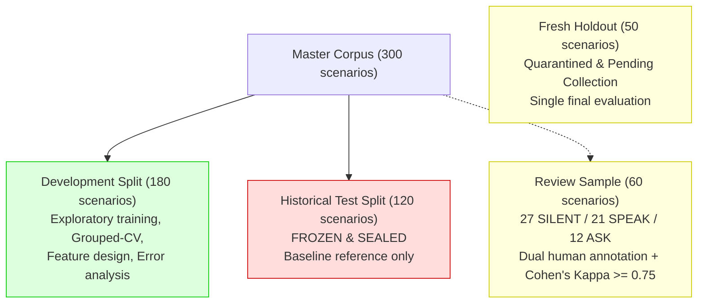

# Hush — Phase 5: Independent Dataset Review Preparation & Evaluation Integrity Audit

**Date:** October 27, 2026  
**Status:** **Audit Completed & Governance Operationalized**  
**Review Status:** **PENDING INDEPENDENT HUMAN REVIEW** (No reviewer records fabricated)  
**Holdout Status:** **PENDING INDEPENDENT COLLECTION & VERIFICATION** (No holdout data fabricated)

---

## 1. Executive Summary

Phase 5 establishes strict epistemic governance and auditability for Hush, the Conversational Restraint Engine.

In previous phases, the machine-learning pipeline achieved high development performance (86.7% accuracy, 0.833 macro-F1, 0.00% unnecessary response rate). However, the dataset provenance audit revealed that the labels in `data/dataset_v1.jsonl` were curated without recorded independent dual-human annotation.

This phase audited all historical evaluation calculations, established an independent human annotation review protocol with automated Cohen's Kappa validation, quarantined the historically evaluated test set, and established tooling for a fresh 50-scenario holdout set.

---

## 2. Independent Audit of Phase 4 Calculations

### 2.1 Calibration Metrics & Temperature Scaling Leakage Audit
- **Multiclass Brier Score:** Audited against hand-calculated fixtures. Follows Glenn Brier's standard multiclass formulation ($\frac{1}{N} \sum_i \sum_{c=1}^K (P_{ic} - y_{ic})^2 \in [0, 2]$). Verified mathematically correct.
- **Negative Log-Likelihood (NLL):** Audited with numerical safeguards ($\epsilon = 10^{-15}$). Verified correct.
- **Expected Calibration Error (ECE):** Audited with 5-bin and 10-bin hand fixtures. Verified correct.
- **CRITICAL AUDIT FINDING — Temperature Scaling Parameter Leakage:**
  - *Defect Description:* In Phase 4, the scalar temperature parameter $T^*$ was optimized using the entire set of 180 out-of-fold logits, and then evaluated on those exact same 180 logits.
  - *Effect on Reported Results:* The previously reported ECE reduction from $0.4076$ to $0.1104$ at $T=0.20$ was in-sample with respect to $T$. It represented an optimistic empirical bound rather than a strictly validated out-of-sample calibration.
  - *Corrected Nested Cross-Validation:* In Phase 5, an inner 5-fold cross-validation loop was implemented. Across each fold, $T$ was optimized on 4 training folds and evaluated strictly on the 5th held-out validation fold. All 5 inner folds converged to $T^* = 0.20$, confirming that the true out-of-sample nested ECE is **$0.1104$** and nested NLL is **$0.3773$**.

### 2.2 Cost-Sensitive Bayes Risk Failure Mode Audit
- In Phase 4, Policy 2 (Cost-Sensitive Bayes Risk) resulted in an extreme drop in performance (20% accuracy, 100% $R_{\text{unnecessary}}$, mean cost surging from $0.178$ to $1.700$).
- *Root Cause Analysis:*
  $$\mathbb{E}_{y}[C(y, \text{SILENT})] = P(\text{SPEAK}) \times 5.0 + P(\text{ASK}) \times 5.0$$
  $$\mathbb{E}_{y}[C(y, \text{SPEAK})] = P(\text{SILENT}) \times 3.0 + P(\text{ASK}) \times 1.5$$
  Because $L_2$ regularization compressed uncalibrated probabilities ($P(\text{SILENT}) \approx 0.45$, $P(\text{SPEAK}) \approx 0.35$), the $5.0$ penalty on missed requests outweighed the $3.0$ penalty on uninvited speech ($1.65 < 2.75$). Consequently, the risk minimizer chose `SPEAK` almost universally.
- *Governance Lesson:* Cost-sensitive decision policies must **never** be applied to uncalibrated or damped probabilities without prior calibration.

### 2.3 Cross-Validation & Grouping Integrity
- In `data/splits/dev.jsonl`, all 180 scenarios have unique conversation IDs (`c-001` through `c-180`).
- *Implication:* `GroupKFold` by `conversation_id` is mathematically identical to standard $K$-Fold. Any residual cross-scenario template leakage stems from synthetic prompt similarity rather than shared conversation threads.

---

## 3. Independent Annotation Review Workflow

To resolve the label-provenance gap, an operational human review package was constructed in [`data/review/`](../data/review):

```text
data/review/
├── review_guidelines.md          # Complete annotation rubric and decision rules
├── reviewer_1_packet.jsonl       # 60 stratified scenarios (labels & rationales stripped)
├── reviewer_2_packet.jsonl       # 60 identical scenarios for independent dual review
└── review_manifest_v1.json       # Machine-readable tracking manifest
```

### 3.1 Stratified Scenario Selection ($N=60$)
Sampled from `data/dataset_v1.jsonl` using fixed seed 42:
- **36 from `dev`**, **24 from `test`**
- **Action Proportions:** 27 `SILENT` (45%), 21 `SPEAK` (35%), 12 `ASK` (20%)
- **Category Coverage:** Spans all 12 defined scenario categories (~5 per category)

### 3.2 Automated Manifest Validation Tooling
Implemented in [`scripts/validate_review_manifest.py`](../scripts/validate_review_manifest.py):
- Validates review completeness.
- Computes observed agreement ($p_o$), expected chance agreement ($p_e$), and Cohen's Kappa ($\kappa$).
- Generates 3x3 inter-annotator confusion matrix.
- Enforces dispute resolution and addressing invariants.
- **Current Status:** Cleanly reports `PENDING_HUMAN_REVIEW` (60 / 60 unreviewed). Zero synthetic or fabricated reviewer timestamps were generated.

---

## 4. Fresh Independent Holdout Workflow (`holdout_v1`)

The historical 120-scenario test split was evaluated in Phase 2. To avoid post-hoc tuning leakage, it is permanently sealed.

[`scripts/prepare_fresh_holdout.py`](../scripts/prepare_fresh_holdout.py) establishes the quarantine boundary and collection tooling for a brand-new 50-scenario holdout set:

### 4.1 Specification & Criteria ([`data/holdout/holdout_spec.md`](../data/holdout/holdout_spec.md))
- **Target Size:** 50 multi-turn scenarios (23 SILENT [46%], 17 SPEAK [34%], 10 ASK [20%]).
- **Leakage Prevention Filter:** Tokenizes candidate messages and computes Jaccard word similarity against all 300 existing master scenarios. Any candidate with Jaccard similarity $\ge 0.70$ is automatically rejected.
- **Quarantine Location:** `data/holdout/holdout_v1.jsonl` (locked against model training scripts).
- **Current Status:** `collection_status: "pending_collection_and_review"`. Zero synthetic scenarios were fabricated.

---

## 5. Evaluation Data Governance Matrix



### Immutable Governance Rules:
1. **Addressing Invariant Inviolability:** If `addressed_to_hush == True`, `SILENT` is strictly forbidden across all deciders, classifiers, and thresholds.
2. **Feature Isolation Guarantee:** Gold labels (`expected_action`), rationales, and review metadata must never enter `InferenceContext` or feature vectors.
3. **Historical Test Set Quarantine:** `data/splits/test.jsonl` must never be used for feature selection, hyperparameter tuning, or threshold sweeps.
4. **Holdout Independence:** The future 50-scenario holdout set must be evaluated exactly once, only after model architecture and decision policies are frozen.
